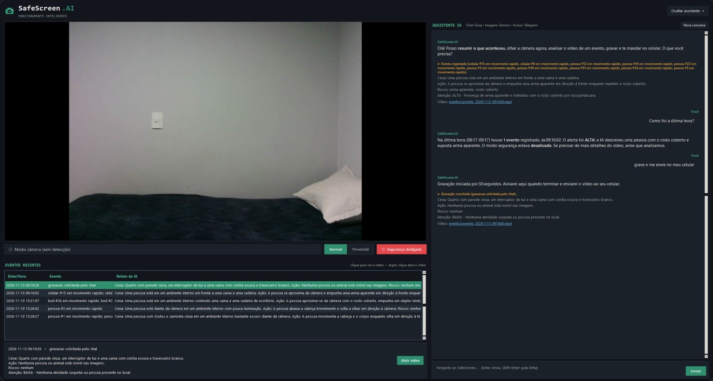
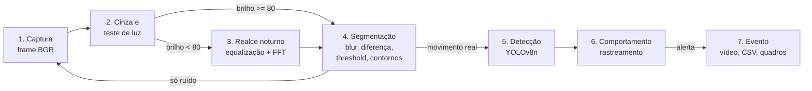
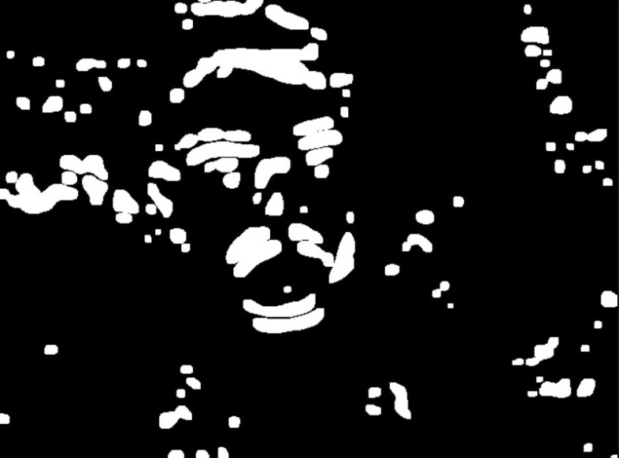
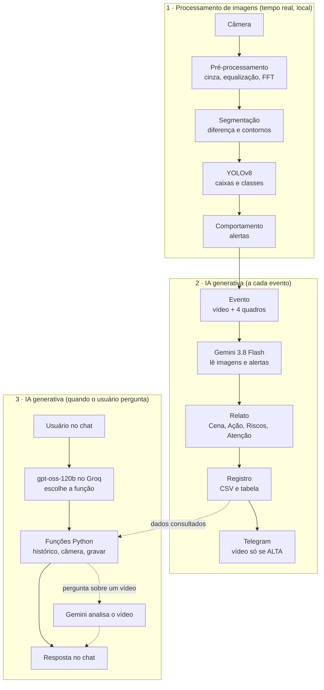
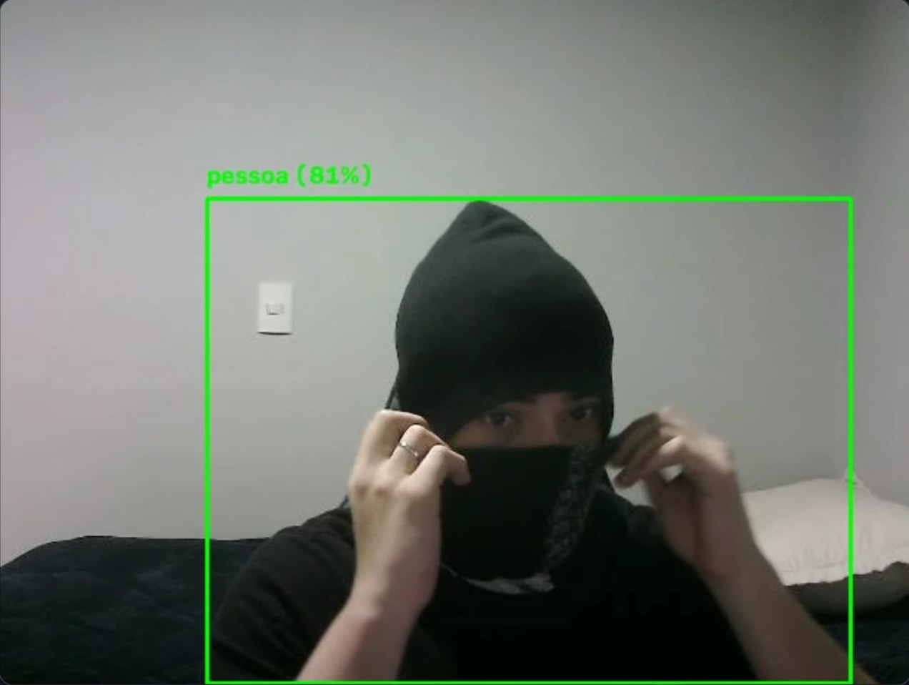
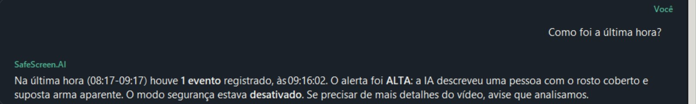
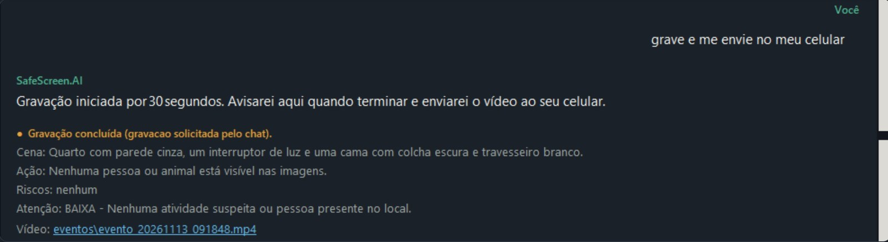

# SafeScreen.AI

**Monitoramento noturno por câmera com processamento de imagens e IA generativa.**

O SafeScreen.AI detecta movimento com uma webcam comum, inclusive no escuro, identifica o que se moveu (pessoa, animal ou objeto) e analisa o comportamento. Depois, usa IA generativa para escrever um relato de cada evento com nível de risco, avisar no celular pelo Telegram e responder perguntas num chat (“como foi a última hora?”, “grave 30 segundos e me mande”).

Projeto das disciplinas **Processamento de Imagens e Sinais** e **IA Generativa**.



---

## Sumário

1. [Integrantes](#1-integrantes)
2. [Descrição do projeto e pipeline de processamento de imagens](#2-descrição-do-projeto-e-pipeline-de-processamento-de-imagens)
3. [Integração com a disciplina de IA e pipeline completo](#3-integração-com-a-disciplina-de-ia-e-pipeline-completo)
4. [Requisitos e instalação](#4-requisitos-e-instalação)
5. [Datasets utilizados](#5-datasets-utilizados)
6. [Estrutura do código](#6-estrutura-do-código)
7. [Limitações e próximos passos](#7-limitações-e-próximos-passos)
8. [Uso de IA no desenvolvimento](#8-uso-de-ia-no-desenvolvimento)

---

## 1. Integrantes

| Nome completo |
|---|
| Guilherme Henrique Carloni de Carvalho |
| Henrique Augusto Forti |
| Daniel Shinji Onoue |
| Leonardo de Oliveira Prata |
| Ryan Taquita Konda |
| Matheus de Farias Garcia |

Professor: Prof. Dr. Vinicius Santos Andrade

---

## 2. Descrição do projeto e pipeline de processamento de imagens

### 2.1 Problema

Lojas e pequenas empresas dependem de câmeras que quase ninguém assiste. À noite o problema piora: a vigilância humana é menor e a imagem fica escura e cheia de ruído. Os detectores de movimento comuns disparam com sombra ou cortina, não dizem **o quê** se moveu nem se é perigoso, e achar o momento importante exige assistir à gravação inteira.

### 2.2 Objetivo

Um sistema que:

- detecta movimento mesmo em pouca luz;
- identifica o que causou o movimento;
- analisa o comportamento ao longo do tempo (parado, correndo, fora do horário);
- grava e registra cada evento;
- usa IA generativa para descrever o evento, avisar no celular e responder perguntas.

**Público:** lojas, comércios e pequenas empresas, com foco no turno da noite.

### 2.3 Dados de entrada

| Tipo | Detalhe |
|---|---|
| Origem | Vídeo RGB contínuo de uma webcam, lido com OpenCV (`cv2.VideoCapture`) |
| Formato | Frames BGR de 8 bits, convertidos para escala de cinza na análise |
| Resolução | A da câmera (640×480 a 1280×720); reduzida para até 640 px antes do YOLO |
| Taxa | O FPS informado pela câmera; se ela não informa, o sistema assume 20 |
| Cenário | Ambientes internos, com foco em pouca luz |

### 2.4 Pipeline de processamento de imagens

Todo o processamento de imagens roda **em tempo real, no próprio computador**, sem depender da internet. São sete etapas; cada uma recebe a saída da anterior.



| # | Etapa | O que faz | Entrega |
|---|---|---|---|
| 1 | Captura | Lê os frames da webcam numa thread separada | frame BGR |
| 2 | Cinza e teste de luz | Converte para cinza e mede o brilho médio | imagem em cinza |
| 3 | Realce noturno | Só se o brilho for menor que 80: equalização e FFT passa-baixa | cinza sem ruído |
| 4 | Segmentação | Blur, diferença entre frames, threshold e contornos | regiões que mudaram |
| 5 | Detecção (YOLOv8) | Classifica o que se moveu, uma vez por frame | caixas e classes |
| 6 | Comportamento | Rastreia cada objeto: parado, correndo, fora do horário | alertas |
| 7 | Evento | Grava o vídeo, registra e separa 4 quadros para a IA | .mp4, CSV e quadros |

#### Etapa 1 · Captura (`captura.py`)

O `cv2.VideoCapture` lê a webcam continuamente. A leitura e toda a análise rodam numa **thread separada** da interface e mandam os resultados por uma fila. Assim, a janela não trava enquanto o YOLO e a IA processam, que foi o principal problema de desempenho do projeto.

#### Etapa 2 · Escala de cinza e teste de luz (`detectmov.py`)

```python
cinza = cv2.cvtColor(frame, cv2.COLOR_BGR2GRAY)
noite = cinza.mean() < 80          # BRILHO_LIMIAR_NOTURNO
```

- **Por que cinza:** para detectar movimento só importa a intensidade, e um canal é três vezes mais leve que três.
- **Teste de luz:** o brilho médio do frame, numa escala de 0 a 255, decide o modo. Abaixo de 80 o ambiente é considerado escuro e a etapa 3 é ativada.

#### Etapa 3 · Realce noturno: equalização e FFT (`detectmov.py`, `analise_fft.py`)

Esta etapa **só roda no escuro** e tem duas partes.

**Equalização de histograma.** O `cv2.equalizeHist` espalha os tons escuros por toda a faixa de 0 a 255 e aumenta o contraste entre o objeto e o fundo, que à noite costuma ser sutil demais.

**Filtro passa-baixa no domínio da frequência (FFT).** No escuro, o sensor da câmera amplifica o sinal e produz um grão, que é ruído de **alta frequência**. Formas e fundo são **baixa frequência**. O filtro mantém as baixas e corta as altas:

1. **FFT 2D:** `np.fft.fft2` leva o frame em cinza do domínio espacial para o da frequência.
2. **fftshift:** `np.fft.fftshift` move a frequência zero (DC) e as baixas frequências para o centro do espectro.
3. **Máscara circular:** um círculo de raio 40 (`RAIO_CORTE_FFT`) mantém o centro e zera o resto, onde estão as altas frequências.
4. **IFFT 2D:** `np.fft.ifftshift` e `np.fft.ifft2` trazem a imagem de volta ao domínio espacial, sem as frequências cortadas. O módulo é limitado a 0–255 e convertido para `uint8`.

```python
espectro = np.fft.fftshift(np.fft.fft2(imagem_cinza))
mascara  = distancia_do_centro <= raio_corte          # círculo passa-baixa
imagem   = np.abs(np.fft.ifft2(np.fft.ifftshift(espectro * mascara)))
```

**Por que não usar só o blur:** o `GaussianBlur` sozinho teria de borrar muito a imagem para tirar esse ruído. A FFT ataca justamente as frequências do ruído e preserva melhor as formas.

- **Magnitude:** mostra a intensidade de cada componente de frequência; com o fftshift, as baixas ficam no centro e as altas nas bordas.
- **Fase:** guarda a posição de bordas e formas. A máscara preserva magnitude e fase das frequências centrais, por isso a fase não é analisada à parte.

Para gerar o painel do espectro e o antes e depois com a câmera real, rode `python gerar_evidencias.py --forcar-noite`.

#### Etapa 4 · Segmentação de movimento (`detectmov.py`)



*Threshold real no escuro: branco = diferença entre frames, incluindo um pouco de ruído.*

| Passo | Operação | Parâmetro |
|---|---|---|
| a | `cv2.GaussianBlur` suaviza o ruído fino | kernel 21×21 |
| b | `cv2.absdiff` compara o frame atual com o anterior | — |
| c | `cv2.threshold` binariza: o que mudou fica branco | limiar 25 |
| d | `cv2.dilate` fecha os buracos nas regiões brancas | 2 iterações |
| e | `cv2.findContours` agrupa o branco em regiões | contornos externos |
| f | Filtro de ruído descarta regiões pequenas | área > 500 px² e lado ≥ 30 px |

Só quando sobra pelo menos uma região depois do filtro o frame é considerado **movimento real** e segue para a etapa 5.

**Verificação:** as regiões brancas devem coincidir com o que realmente se moveu. Um objeto parado ou ruído virando região é falso positivo; movimento sem região é falso negativo. Até agora a verificação foi visual (veja o item 7).

#### Etapa 5 · Detecção de objetos com YOLOv8 (`ia_classificacao.py`)

- **Modelo:** `yolov8n.pt` (versão *nano*, a mais leve), pré-treinado no dataset COCO com 80 classes. As classes são traduzidas para português (`person` → `pessoa`).
- **Saída:** para cada objeto, uma **caixa** (x, y, largura, altura), a **classe** e a **confiança**. O modelo de detecção não gera máscara por pixel (isso só existe no `yolov8n-seg.pt`).
- **Quando roda:** uma vez por frame, e só quando a etapa 4 encontrou movimento real. Antes rodava uma vez por contorno, e a interface travava.
- **Confiança mínima:** 0,3 à noite e 0,4 de dia.
- **Limitação:** a caixa inclui parte do fundo, e o COCO não tem a classe arma. Nos testes, o YOLO chamou uma arma de “celular”. Esse é um dos motivos da integração com a IA generativa (seção 3).

#### Etapa 6 · Análise de comportamento (`analise_comportamento.py`)

O YOLO diz o que existe em cada frame, mas não liga um frame ao seguinte. Para isso o sistema usa **rastreamento por centroide**:

1. Cada caixa vira um ponto central.
2. No frame seguinte, o centro mais próximo, a até 80 px, é o mesmo objeto e mantém o ID.
3. A distância percorrida por segundo dá a **velocidade**; o tempo no mesmo lugar dá o **tempo parado**.

| Regra | Condição | Alerta |
|---|---|---|
| Parado | Moveu menos de 5 px por 10 s ou mais | objeto parado no mesmo lugar |
| Correndo | Velocidade acima de 300 px/s | movimento rápido |
| Fora do horário | Pessoa detectada entre 22h e 8h | fora do horário comercial |

#### Etapa 7 · Evento: gravação e registro (`buffer_eventos.py`, `registro_eventos.py`)

- Um **buffer circular** (`deque`) guarda sempre os últimos **15 s** de frames na memória.
- No alerta, o vídeo inclui esses 15 s anteriores e continua gravando até **5 s** depois do último alerta.
- O vídeo é salvo em `.mp4` com o `cv2.VideoWriter`, numa thread, sem travar a câmera.
- O evento (data, alertas, caminho do vídeo e relato da IA) vai para `eventos/registro_eventos.csv` e para a tabela da interface.
- **Quatro quadros** (o do alerta e mais 3 espalhados pelo evento) seguem junto com os alertas para a IA generativa. Aqui o processamento de imagens entrega o evento para a seção 3.

---

## 3. Integração com a disciplina de IA e pipeline completo

**Sim, há integração, e nos dois sentidos.**

1. **O processamento de imagens alimenta a IA.** Os 4 quadros do evento e os alertas do YOLO e do comportamento entram no prompt do Gemini. O processamento de imagens diz *onde* e *o quê*; a IA diz *o que significa*.
2. **A IA controla o sistema.** O nível de Atenção escrito pela IA decide se o vídeo vai para o celular. No chat, a LLM chama funções Python que gravam, consultam o histórico e analisam vídeos.

**Por que integrar:** o YOLO não reconhece armas e o threshold dispara com ruído. A IA generativa revisa cada evento com contexto e explica o risco em português. E, se a IA na nuvem cair, a detecção, a gravação e o registro continuam funcionando, porque rodam no computador.

### 3.1 Pipeline completo



**Faixa 1:** é o pipeline da seção 2.

**Faixa 2:** a cada evento, o Gemini recebe os quadros e os alertas e responde sempre no mesmo formato:

```
Cena: uma pessoa em um ambiente interno, em frente a uma cama e uma cadeira.
Ação: se aproxima da câmera e empunha uma arma aparente, com o rosto coberto.
Riscos: arma aparente, rosto coberto
Atenção: ALTA
```

O código lê a linha `Atenção` com uma expressão regular e decide o envio:

| Situação | No celular (Telegram) |
|---|---|
| Atenção ALTA | Alerta e vídeo |
| Atenção MÉDIA ou BAIXA | Só a mensagem |
| Gravação pedida pelo chat | Mensagem e vídeo |

Antes do envio, o vídeo é convertido para **H.264 em 640 px** com o ffmpeg, para tocar no celular e chegar em segundos.

**Faixa 3:** o chat usa **function calling**. O nome, a docstring e os tipos de cada função viram um JSON Schema enviado à LLM. A LLM não executa nada sozinha: ela pede uma função, o código Python executa e devolve o resultado, e então a LLM escreve a resposta com os dados reais. O laço tem no máximo 6 rodadas.

```python
for _ in range(6):
    msg = groq(mensagens, ferramentas)
    if not msg.tool_calls:
        return msg.content                       # resposta final
    for chamada in msg.tool_calls:
        funcao = funcoes[chamada.nome]
        resultado = funcao(**chamada.argumentos)
        mensagens.append({"role": "tool", "content": json(resultado)})
```

| Pedido do usuário | Função chamada |
|---|---|
| “Como foi a última hora?” | `consultar_historico` |
| “Tinha arma no vídeo?” | `analisar_video` (o Gemini assiste a quadros do vídeo) |
| “O que acontece agora?” | `ver_camera_agora` |
| “Grave e me mande” | `gravar_video` (no máximo 300 s) |
| “Abre o último vídeo” | `abrir_video` |
| “Manda um resumo” | `enviar_celular` |
| “Desliga a segurança” | `alterar_seguranca` |

### 3.2 Modelos de IA

| Modelo | Tipo | Papel | Entra | Sai |
|---|---|---|---|---|
| **gpt-oss-120b** no Groq | LLM de texto | Chat e function calling | pergunta, histórico e resultados das funções | resposta ou pedido de função |
| **Gemini 3.8 Flash** (Google) | LLM multimodal | Relato do evento e análise de vídeo | 4 a 6 quadros e o prompt | Cena, Ação, Riscos e Atenção |
| **YOLOv8n** (Ultralytics) | Rede convolucional, não é LLM | Detecção de objetos | frame com movimento | caixas e rótulos |

### 3.3 Engenharia de prompt

Cada regra nasceu de um erro observado nos testes:

- **Relato (Gemini):** “O YOLO NÃO reconhece armas: use as IMAGENS como fonte principal.” · “Uma arma de brinquedo não pode ser diferenciada de uma real: chame de arma aparente.” · “Não identifique pessoas nem deduza etnia ou idade.”
- **Assistente (Groq):** “NUNCA invente eventos, horários ou o que a câmera está mostrando.” · “Perguntas sobre o conteúdo de um vídeo: use analisar_video.”

Cada chamada à IA fica salva em `eventos/log_prompts.jsonl` (prompt, resposta e tempo) para auditoria.

### 3.4 Robustez

APIs de nuvem falham. Quando a chamada dá um erro temporário (503, 504 ou 429), o sistema tenta automaticamente outros modelos disponíveis na conta, do mais novo para o mais antigo. O primeiro que responde vira o modelo principal. Erros que não são temporários, como chave inválida, aparecem como mensagem clara na interface.

### 3.5 Teste real: pessoa mascarada



1. **Processamento de imagens + YOLO:** detectou a pessoa (“pessoa 81%”), mas chamou a arma de “celular”.
2. **Gemini:** identificou arma aparente e rosto coberto, com **Atenção: ALTA**.
3. **Telegram:** chegou o alerta de risco alto com o vídeo.





### 3.6 Avaliação

O script `avaliar_ia.py` analisa os vídeos de eventos gravados e gera `eventos/avaliacao_ia.csv`, com o que o YOLO viu, o que o Gemini respondeu e o tempo de resposta. O grupo preenche o gabarito, e `python avaliar_ia.py --resumo` calcula a taxa de acerto.

| Métrica | Resultado |
|---|---|
| Cenas com o nível de risco correto | 9 de 10 |
| Tempo médio de uma análise do Gemini | cerca de 10 s |

---

## 4. Requisitos e instalação

As dependências estão em [`requirements.txt`](requirements.txt). É recomendado usar o **Python 3.12**: o PyTorch, que o Ultralytics instala, deu erro de DLL no Python 3.14.

```bash
git clone https://github.com/<usuario>/<repositorio>.git
cd <repositorio>
python -m venv .venv
.venv\Scripts\activate          # Windows  (Linux/macOS: source .venv/bin/activate)
pip install -r requirements.txt
```

### Chaves de API

As chaves **não estão no repositório**. Elas são lidas de variáveis de ambiente:

| Variável | Para quê | Onde criar (grátis) |
|---|---|---|
| `GEMINI_API_KEY` | Relato dos eventos e análise de vídeo | https://aistudio.google.com/apikey |
| `GROQ_API_KEY` | Chat com function calling | https://console.groq.com/keys |
| `TELEGRAM_TOKEN` | Aviso no celular | @BotFather no Telegram |

```powershell
# Windows (PowerShell), no mesmo terminal que vai rodar o programa
$env:GEMINI_API_KEY = "sua-chave"
$env:GROQ_API_KEY   = "sua-chave"
$env:TELEGRAM_TOKEN = "seu-token"
```

Depois de criar o bot no Telegram, mande qualquer mensagem para ele. O sistema descobre o seu `chat_id` sozinho e o salva em `eventos/telegram_chat_id.txt`.

Sem as chaves, a detecção, a gravação e o registro funcionam normalmente; só o relato, o chat e o aviso no celular ficam desativados.

### Executar

```bash
python main.py                      # aplicação completa
python notificacao.py               # testa o Telegram com o último vídeo
python avaliar_ia.py 10             # avalia a IA nos 10 eventos mais recentes
python gerar_evidencias.py          # gera painéis de segmentação e FFT e métricas simples
```

O arquivo `SafeScreenAI.spec` gera um executável com o PyInstaller: `pyinstaller SafeScreenAI.spec`.

---

## 5. Datasets utilizados

O projeto **não treinou nenhum modelo**. Ele usa modelos pré-treinados e imagens capturadas ao vivo pela webcam.

| Dataset | Uso no projeto | Link |
|---|---|---|
| **COCO 2017** (Common Objects in Context), 80 classes | Treinamento dos pesos do YOLOv8n (`yolov8n.pt`) usados na detecção de objetos | https://cocodataset.org · https://docs.ultralytics.com/datasets/detect/coco/ |
| Pesos YOLOv8n pré-treinados (Ultralytics) | Baixados automaticamente na primeira execução | https://docs.ultralytics.com/models/yolov8/ |
| Vídeos de teste próprios | Cenas gravadas pelo grupo com a webcam (vazia, pessoa passando, rosto coberto, arma de brinquedo, celular na mão), usadas nos testes e no `avaliar_ia.py` | Não publicados: contêm imagens dos integrantes |

O Gemini (Google) e o gpt-oss-120b (OpenAI, servido pelo Groq) são usados por API, já treinados pelos fabricantes; o grupo não teve acesso aos dados de treino desses modelos.

---

## 6. Estrutura do código

| Arquivo | Papel |
|---|---|
| `main.py` | Ponto de entrada: inicia a interface |
| `interface.py` | Janela Tkinter: câmera, tabela de eventos e chat |
| `tema.py` | Cores e estilo da interface |
| `captura.py` | Thread da câmera: lê frames e chama a detecção |
| `detectmov.py` | Etapas 2 a 5: cinza, modo noturno, segmentação e chamada do YOLO |
| `analise_fft.py` | Filtro passa-baixa no domínio da frequência (FFT) |
| `ia_classificacao.py` | YOLOv8n: detecção e tradução das classes |
| `analise_comportamento.py` | Rastreamento por centroide e regras de comportamento |
| `buffer_eventos.py` | Buffer de 15 s, gravação do vídeo e envio dos quadros à IA |
| `registro_eventos.py` | CSV de eventos e de atividade |
| `ia_generativa.py` | Gemini, Groq, prompts, function calling e troca de modelo |
| `notificacao.py` | Telegram: texto ou vídeo conforme o nível de atenção |
| `notificacao_whatsapp.py` | Alternativa por WhatsApp (CallMeBot), desativada por padrão |
| `chat_markdown.py` | Formata as respostas da LLM (negrito, listas, tabelas) no chat |
| `avaliar_ia.py` | Mede a taxa de acerto e o tempo da IA |
| `gerar_evidencias.py` | Gera painéis reais de segmentação e FFT e métricas simples |

---

## 7. Limitações e próximos passos

| Limitação | Próximo passo |
|---|---|
| No escuro, o threshold ainda marca ruído (falsos positivos) | Medir o ruído antes e depois da FFT e a taxa de falso positivo e negativo |
| Limiares (brilho, velocidade, tempo parado) calibrados à mão | Calibrar com testes de campo, numa loja real à noite |
| O YOLO não tem a classe arma, e a IA não distingue arma de brinquedo de arma real | Treinar um detector com armas e objetos de risco |
| O relato e o chat dependem de serviços na nuvem e do plano gratuito | Testar um modelo de visão local, sem enviar imagens para fora |
| A caixa do YOLO inclui fundo | Usar o `yolov8n-seg.pt` para contorno exato |

---

## 8. Uso de IA no desenvolvimento

Conforme pedido no trabalho, declaramos o uso de IA: o **Claude** (Anthropic) foi usado para gerar e depurar código, explicar erros e redigir a documentação e os slides. O grupo definiu o projeto, testou tudo com a câmera real e revisou o resultado.
